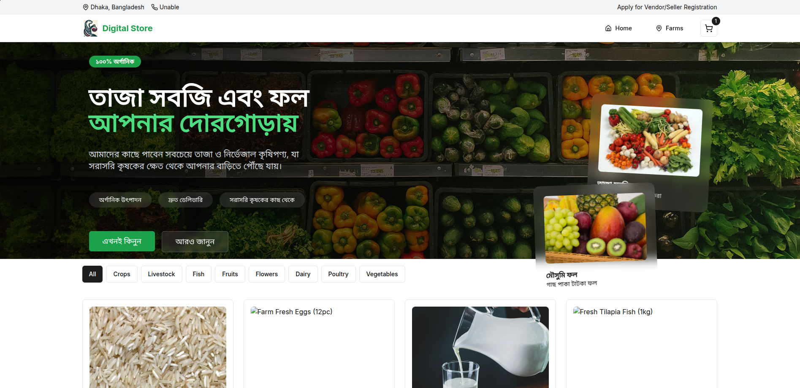

# Digital Store

Digital Store is a farm-to-home marketplace concept for discovering and shopping for fresh agricultural products in Bangladesh. It connects customers with product categories and nearby farms through a responsive e-commerce interface.

## Project Preview



## Features

- Browse products across crops, livestock, fish, fruits, flowers, dairy, poultry, and vegetables.
- Filter the product catalog by category and explore curated product lists.
- Add products to a shopping cart and proceed through a shipping, payment-method, and order-confirmation flow.
- Discover nearby farms in Dhaka using a searchable, category-filtered list and interactive map.
- View informational pages for the project, contact, FAQs, order tracking, terms, privacy, and returns.
- Use a responsive layout with a mobile navigation menu.

## Tech Stack

- **Framework:** Next.js 13 with the App Router
- **Language:** TypeScript and React 18
- **Styling:** Tailwind CSS, Radix UI, and `class-variance-authority`
- **Icons:** Lucide
- **Maps:** Leaflet and React Leaflet
- **Forms and notifications:** React Hook Form, Zod, and Sonner
- **Email integration:** EmailJS browser SDK

## Getting Started

### Requirements

- Node.js and npm

### Install and run

```bash
npm install
npm run dev
```

Open [http://localhost:3000](http://localhost:3000) to view the app.

### Available scripts

```bash
npm run dev      # Start the development server
npm run build    # Create a production build
npm run start    # Serve the production build
npm run lint     # Run Next.js lint checks
```

## Main Routes

| Route | Description |
| --- | --- |
| `/` | Product catalog, category filters, promotions, and featured lists |
| `/nearby-shops` | Searchable farm directory and map |
| `/checkout` | Multi-step checkout and order summary |
| `/about` | Project mission and values |
| `/contact` | Contact details and message form |
| `/faq` | Frequently asked questions |
| `/track-order` | Order tracking page |
| `/terms-of-service` | Terms of service |
| `/privacy-policy` | Privacy policy |
| `/returns-policy` | Returns policy |

## Configuration Notes

Product and farm listings are currently defined in the project source. Contact and order-confirmation emails use EmailJS, but the code contains placeholder service, template, and public-key values; configure these before expecting email delivery.
